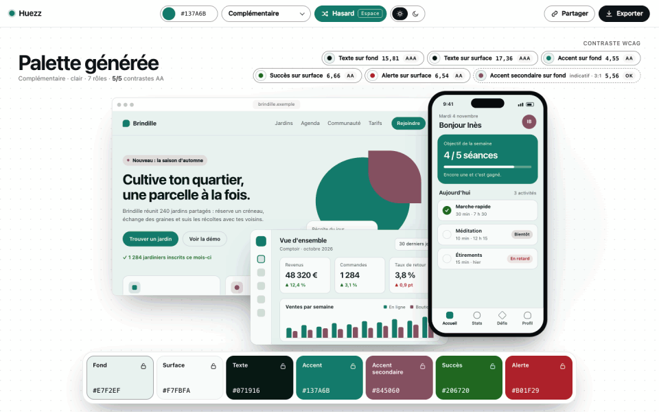
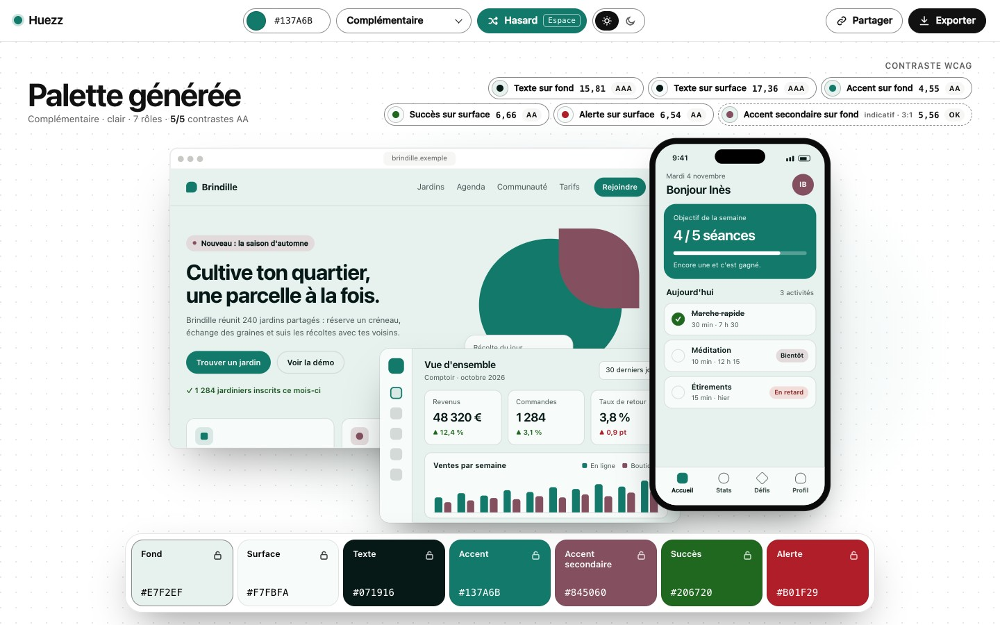
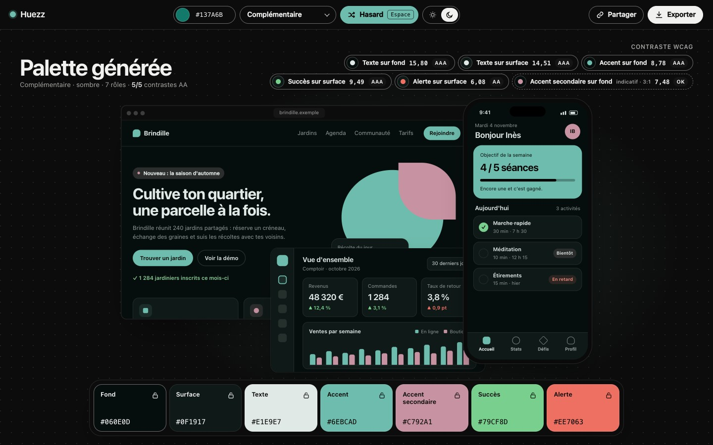
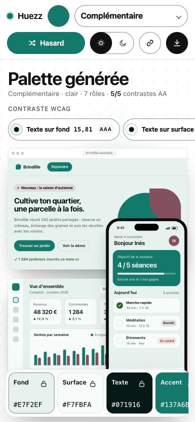

<p align="center">
  
</p>

<p align="center"><a href="#english">English</a> · <a href="#francais">Français</a></p>

<a id="english"></a>

# Huezz

**Pick a mood, get a coherent colour palette, and see it at once on three real mock-ups.** A static site (TypeScript + Vite, no runtime dependency): OKLCH palettes, a WCAG contrast check with a one-click fix, light and dark, 7 export outputs and a link that holds the whole palette.

*The GIF above (10 s): five presses of Random (the palette and the three mock-ups change live), one harmony change, the dark palette, the contrast detail of a pair, then the export menu on CSS and Swift. The interface is in French only; there is no translation yet.*

Demo: <https://malikchopa.github.io/huezz/> (**available only once GitHub Pages is enabled on the repository; not online yet**).

| Light | Dark | Phone (390 px) |
|---|---|---|
|  |  |  |

### Features

1. Generate a palette from a base colour (colour field or hex code) with a harmony.
2. A palette of 7 roles: background, surface, text, accent, secondary accent, success, alert.
3. Live preview on 3 mock-ups: a website, a mobile app, a dashboard.
4. Lock any role, then draw again with the Random button or the Space key; the locked colours stay.
5. WCAG contrast check (AA and AAA) on 6 pairs, a detail window, and a Fix button that moves the lightness of a colour until the target is reached.
6. Light and dark palettes; the first mode follows the system, a switch changes it.
7. Export: CSS, Tailwind (v4 and v3), JSON, Swift, Figma tokens, PNG.
8. A share link: the whole palette is in the address (the part after `#`).
9. One-click copy of any colour (Enter on the keyboard) and of the export text.
10. Keyboard use and a phone layout.

The first palette is random at every visit; a share link restores a palette exactly (the 14 colours and the locks are stored in it).

### Harmonies (6)

Complementary (+180°), analogous (±40°), triad (+120°, +240°), tetrad (+90°, +180°, +270°), monochrome, split-complementary (+150°, +210°).

### Exports (7 outputs)

CSS variables (with a dark `@media` block), Tailwind v4 (`@theme`), Tailwind v3 (`darkMode: 'media'`), JSON, a Swift file, Figma tokens (`#RRGGBB` by default, an option writes the 2025.10 format), PNG (7 bands, 1400 x 400). Every text output names Huezz and the harmony at the very top (the first line, or the first fields of the JSON and Figma files); none names the mode, because the light and the dark values are both in each file (only the PNG follows the mode on screen). No output holds an address or a date.

Not verified: the Tailwind outputs were not compiled with Tailwind, and the Figma 2025.10 format was not tried in Figma or Tokens Studio (the interface says so). The Swift output passes `swiftc -typecheck` (Apple Swift 6.4, 2026-11-01).

### Accessibility, and exactly what was tested

- axe-core: the tests assert 0 serious or critical violations on 8 page states (system light and dark, export menu or contrast window open, 1440 and 390 px), 2026-11-01. The independent product audit of the same day ran axe-core on 6 states at 1440 and 390 px and counted 0 violations of any level; three more states (hex error shown, lock tooltip shown, short window with the export sheet scrolled) are asserted at 0 violations of any level.
- Keyboard: 16 tab stops at 1440 px (15 at 390 px) in a planned order, no trap; focus ring at least 3:1 on every stop tested; Escape closes windows and gives the focus back.
- Phone: no horizontal scroll from 1440 down to 320 px; at 390 px every control is at least 24 x 24 px and the main ones at least 44 x 44 px.
- `prefers-reduced-motion` removes the animations; `forced-colors` was emulated; a live region announces a new palette.
- The interface's own colours are checked against WCAG; mock-up texts are at least 4.5:1.

**Tested automatically:** Chrome on Mac (headless, the `chrome` channel) and the **WebKit engine** (Playwright build 2370: this is not Safari itself).
**Not tested:** real Safari, a real iPhone, Firefox, Windows, and any real screen reader (VoiceOver, NVDA, TalkBack). A 10-step manual checklist exists in [docs/CHECKLIST-NAVIGATEURS.md](docs/CHECKLIST-NAVIGATEURS.md); none of its steps has been done yet. Known: WebKit logs one console error per load for the native `<select>` under the page's CSP; nothing visible was lost.

### Privacy

Nothing is sent anywhere: no account, no server, no statistics. The source uses no cookie and no browser storage. The page is a single HTML file with its CSS and JavaScript inline, and a Content Security Policy (in a `<meta>` tag, hash based) that forbids network requests from the page and inline `style` attributes. After loading, every feature works offline (a test cuts the network and uses them all; reloading while offline depends on the browser cache, there is no service worker). The share link keeps the palette in the part after `#`, which browsers do not send to servers.

### Measured numbers (author's Mac, Apple M5, 2026-11-01)

- Page: `dist/index.html` is 100 415 bytes, 29 182 bytes gzipped (`npm run size`).
- Tests: 481 unit tests (55 of them for the release scripts) and 226 end-to-end tests (of which 19 in WebKit and 6 offline); `npm test` and `npm run e2e` run in this repository on 2026-11-02.
- Smoothness while dragging the colour picker (120 input events, Chrome headless, 1440 x 900): handler plus render p95 of 0.6 to 1.3 ms, and 1.6 to 2.6 ms with the CPU slowed 4 times (several runs; the upper end varies with machine load); 0 long task. Measured on desktop Chrome only, not on a phone.

### Install and run

```
git clone https://github.com/MalikChopa/huezz.git && cd huezz
npm ci
npm run dev       # development server (not exercised by the tests)
npm run build     # one file: dist/index.html
npm run check     # typecheck, unit tests, build, size budget, end-to-end tests
```

`npm run check` needs Node 24 and Google Chrome installed (the end-to-end tests drive it with `playwright-core`; no browser is downloaded). The WebKit tests skip themselves when the Playwright WebKit build is absent.

### Tech stack

TypeScript, Vite, Vitest. **No runtime dependency**: the six packages of `package.json` are dev-only (`typescript`, `vite`, `vitest`, `@types/node`, `playwright-core`, `axe-core`). The colour conversions and the GIF encoder of `scripts/gif.mjs` are written in the repository.

Development tools licences: `axe-core` and `lightningcss` (a dependency of Vite) are MPL-2.0. They are development tools only and are not shipped in the built page.

### How the colour maths work

- Colours live in OKLCH (lightness, chroma, hue), through the OKLab matrices published by Björn Ottosson in 2020, written by hand and checked on known values.
- A harmony is a list of hue offsets from the base hue (see above); the rest of the palette is derived from the accent.
- Gamut: when a colour leaves sRGB, the chroma is reduced (lightness and hue kept, bisection); colours are never clipped.
- Contrast is WCAG 2.x (relative luminance ratio; AA 4.5:1 and 3:1 for large text, AAA 7:1 and 4.5:1). The Fix button searches the lightness of a colour, keeping hue and chroma, and re-checks the rounded hex.
- **APCA is not implemented**: its reference repository is not under an open licence, which does not fit MIT.

### Contributing

Issues and pull requests are welcome. Run `npm run check` before sending one. Keep the page free of runtime dependencies and of anything that sends data.

### Licence

MIT, see [LICENSE](LICENSE). Copyright (c) 2026 Chopa.

---

<a id="francais"></a>

# Huezz (français)

**Choisis une ambiance, obtiens une palette de couleurs cohérente, et vois-la tout de suite sur trois vraies maquettes.** Un site statique (TypeScript + Vite, aucune dépendance à l'exécution) : palettes OKLCH, contrôle de contraste WCAG avec correction en un clic, clair et sombre, 7 sorties d'export et un lien qui contient toute la palette.

*Le GIF en haut (10 s) : cinq appuis sur Hasard (la palette et les trois maquettes changent en direct), un changement d'harmonie, la palette sombre, le détail du contraste d'une paire, puis le menu d'export sur CSS et Swift. L'interface est en français seulement ; il n'y a pas de traduction pour l'instant.*

Démo : <https://malikchopa.github.io/huezz/> (**disponible seulement quand GitHub Pages sera activé sur le dépôt ; pas encore en ligne**).

| Clair | Sombre | Téléphone (390 px) |
|---|---|---|
|  |  |  |

### Fonctions

1. Générer une palette depuis une couleur de base (sélecteur ou code hexadécimal) avec une harmonie.
2. Une palette de 7 rôles : fond, surface, texte, accent, accent secondaire, succès, alerte.
3. Aperçu en direct sur 3 maquettes : un site, une application mobile, un tableau de bord.
4. Verrouiller un rôle, puis retirer au hasard avec le bouton Hasard ou la touche Espace ; les couleurs verrouillées restent.
5. Contrôle de contraste WCAG (AA et AAA) sur 6 paires, une fenêtre de détail, et un bouton Corriger qui déplace la luminosité d'une couleur jusqu'à atteindre la cible.
6. Palettes claire et sombre ; le premier mode suit le système, un commutateur le change.
7. Export : CSS, Tailwind (v4 et v3), JSON, Swift, jetons Figma, PNG.
8. Un lien de partage : toute la palette est dans l'adresse (la partie après `#`).
9. Copie en un clic d'une couleur (Entrée au clavier) et du texte d'export.
10. Utilisation au clavier et mise en page pour téléphone.

La première palette est aléatoire à chaque visite ; un lien de partage restitue une palette à l'identique (les 14 couleurs et les verrous y sont inscrits).

### Harmonies (6)

Complémentaire (+180°), analogue (±40°), triade (+120°, +240°), tétrade (+90°, +180°, +270°), monochrome, split-complémentaire (+150°, +210°).

### Exports (7 sorties)

Variables CSS (avec un bloc `@media` sombre), Tailwind v4 (`@theme`), Tailwind v3 (`darkMode: 'media'`), JSON, un fichier Swift, jetons Figma (`#RRGGBB` par défaut, une option écrit le format 2025.10), PNG (7 bandes, 1400 x 400). Chaque sortie texte nomme Huezz et l'harmonie tout en haut (première ligne, ou premiers champs des fichiers JSON et Figma) ; aucune ne nomme le mode, car les valeurs claires et sombres sont toutes deux dans chaque fichier (seul le PNG suit le mode affiché). Aucune sortie ne contient d'adresse ni de date.

Non vérifié : les sorties Tailwind n'ont pas été compilées avec Tailwind, et le format Figma 2025.10 n'a pas été essayé dans Figma ni dans Tokens Studio (l'interface le dit). La sortie Swift passe `swiftc -typecheck` (Apple Swift 6.4, 2026-11-01).

### Accessibilité, et ce qui a été testé exactement

- axe-core : les tests exigent 0 violation sérieuse ou critique sur 8 états de la page (thème système clair et sombre, menu d'export ou fenêtre de contraste ouverts, 1440 et 390 px), 2026-11-01. L'audit produit indépendant du même jour a lancé axe-core sur 6 états à 1440 et 390 px et compté 0 violation de tout niveau ; trois états de plus (erreur du code hex affichée, infobulle de verrou affichée, fenêtre basse avec la feuille d'export défilée) sont exigés à 0 violation de tout niveau.
- Clavier : 16 arrêts de tabulation à 1440 px (15 à 390 px) dans un ordre prévu, sans piège ; anneau de focus d'au moins 3:1 sur chaque arrêt testé ; Échap ferme les fenêtres et rend le focus.
- Téléphone : pas de défilement horizontal de 1440 à 320 px ; à 390 px chaque contrôle fait au moins 24 x 24 px et les principaux au moins 44 x 44 px.
- `prefers-reduced-motion` supprime les animations ; `forced-colors` a été émulé ; une zone vive annonce une nouvelle palette.
- Les couleurs de l'interface elle-même sont contrôlées en WCAG ; les textes des maquettes font au moins 4,5:1.

**Testé automatiquement :** Chrome sur Mac (sans fenêtre, canal `chrome`) et le **moteur WebKit** (build Playwright 2370 : ce n'est pas Safari lui-même).
**Non testé :** Safari réel, iPhone réel, Firefox, Windows, et tout lecteur d'écran réel (VoiceOver, NVDA, TalkBack). Une liste de contrôle manuelle en 10 étapes existe : [docs/CHECKLIST-NAVIGATEURS.md](docs/CHECKLIST-NAVIGATEURS.md) ; aucune de ses étapes n'a encore été faite. Connu : WebKit écrit une erreur de console par chargement pour le `<select>` natif sous la CSP de la page ; rien de visible n'est perdu.

### Vie privée

Rien n'est envoyé nulle part : pas de compte, pas de serveur, pas de statistiques. Le code source n'utilise ni cookie ni stockage du navigateur. La page est un seul fichier HTML avec son CSS et son JavaScript en ligne, et une politique de sécurité de contenu (CSP, dans une balise `<meta>`, par empreintes) qui interdit les requêtes réseau depuis la page et les attributs `style` en ligne. Une fois la page chargée, toutes les fonctions marchent hors ligne (un test coupe le réseau et les utilise toutes ; recharger hors ligne dépend du cache du navigateur, il n'y a pas de service worker). Le lien de partage garde la palette dans la partie après `#`, que les navigateurs n'envoient pas aux serveurs.

### Chiffres mesurés (Mac de l'auteur, Apple M5, 2026-11-01)

- Page : `dist/index.html` fait 100 415 octets, 29 182 octets compressés en gzip (`npm run size`).
- Tests : 481 tests unitaires (dont 55 pour les scripts de livraison) et 226 tests de bout en bout (dont 19 dans WebKit et 6 hors ligne) ; `npm test` et `npm run e2e` lancés dans ce dépôt le 2026-11-02.
- Fluidité pendant le glissement du sélecteur de couleur (120 événements, Chrome sans fenêtre, 1440 x 900) : gestionnaire plus rendu, p95 de 0,6 à 1,3 ms, et de 1,6 à 2,6 ms avec le processeur ralenti 4 fois (plusieurs passes ; le haut de la plage varie avec la charge de la machine) ; 0 tâche longue. Mesuré sur Chrome de bureau seulement, pas sur téléphone.

### Installer et lancer

```
git clone https://github.com/MalikChopa/huezz.git && cd huezz
npm ci
npm run dev       # serveur de développement (non exercé par les tests)
npm run build     # un seul fichier : dist/index.html
npm run check     # typecheck, tests unitaires, build, budget de taille, tests de bout en bout
```

`npm run check` demande Node 24 et Google Chrome installé (les tests de bout en bout le pilotent avec `playwright-core` ; aucun navigateur n'est téléchargé). Les tests WebKit se sautent d'eux-mêmes si le build WebKit de Playwright est absent.

### Technologies

TypeScript, Vite, Vitest. **Aucune dépendance à l'exécution** : les six paquets de `package.json` sont réservés au développement (`typescript`, `vite`, `vitest`, `@types/node`, `playwright-core`, `axe-core`). Les conversions de couleur et l'encodeur GIF de `scripts/gif.mjs` sont écrits dans le dépôt.

Licences des outils de développement : `axe-core` et `lightningcss` (une dépendance de Vite) sont sous MPL-2.0. Ce sont des outils de développement uniquement, non livrés dans la page construite.

### Comment fonctionne le calcul des couleurs

- Les couleurs vivent en OKLCH (luminosité, chroma, teinte), avec les matrices OKLab publiées par Björn Ottosson en 2020, écrites à la main et vérifiées sur des valeurs connues.
- Une harmonie est une liste de décalages de teinte à partir de la teinte de base (voir plus haut) ; le reste de la palette est dérivé de l'accent.
- Gamut : quand une couleur sort de sRGB, la chroma est réduite (luminosité et teinte gardées, dichotomie) ; les couleurs ne sont jamais écrêtées.
- Le contraste suit WCAG 2.x (rapport de luminance relative ; AA 4,5:1 et 3:1 pour le grand texte, AAA 7:1 et 4,5:1). Le bouton Corriger cherche la luminosité d'une couleur en gardant teinte et chroma, et revérifie l'hexadécimal arrondi.
- **APCA n'est pas implémenté** : son dépôt de référence n'est pas sous licence ouverte, ce qui ne va pas avec MIT.

### Contribuer

Les issues et les pull requests sont les bienvenues. Lance `npm run check` avant d'en envoyer une. Garde la page sans dépendance à l'exécution et sans rien qui envoie des données.

### Licence

MIT, voir [LICENSE](LICENSE). Copyright (c) 2026 Chopa.
